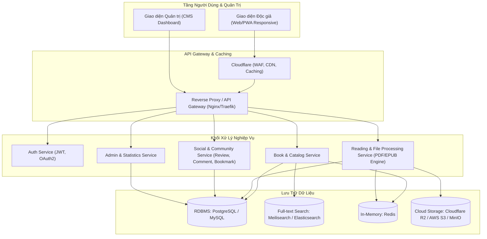
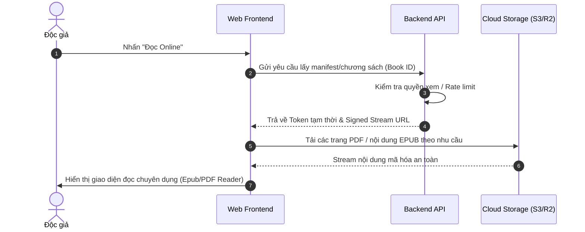
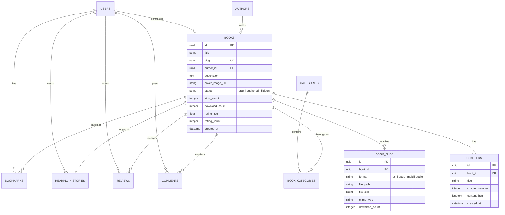
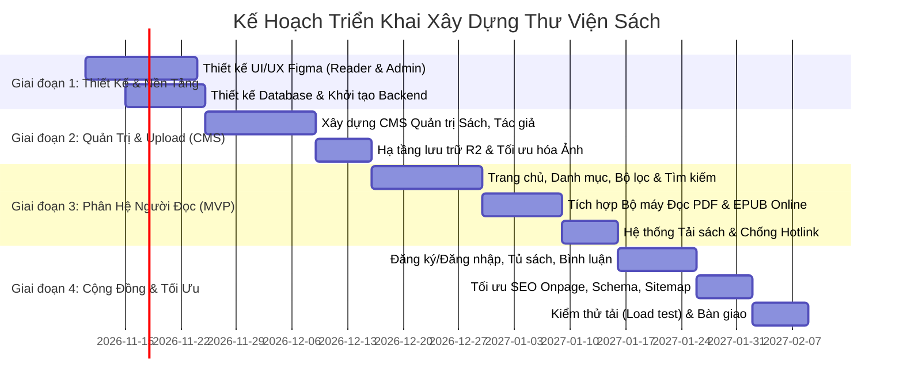

# TÀI LIỆU ĐẶC TẢ YÊU CẦU DỰ ÁN (SRS)
## HỆ THỐNG THƯ VIỆN SÁCH & ĐỌC SÁCH ONLINE

---

## 1. Tổng Quan Dự Án

### 1.1. Mục tiêu
Xây dựng nền tảng thư viện sách số, đọc sách trực tuyến và tải tài liệu (Ebook, PDF, Truyện tranh) tương tự mô hình **thuviensach.vn**. Nền tảng hướng đến:
- Trải nghiệm đọc mượt mà, thân thiện trên đa thiết bị (Desktop, Tablet, Mobile).
- Tối ưu hóa SEO tối đa cho hàng trăm ngàn đầu sách và tác giả.
- Hệ thống quản trị nội dung (CMS) mạnh mẽ, phân quyền rõ ràng, hỗ trợ quản lý đa định dạng (PDF, EPUB, MOBI, Audio).
- Cơ chế bảo vệ bản quyền, quản lý tải về và tối ưu chi phí hạ tầng lưu trữ.

### 1.2. Phân loại người dùng (User Roles)
1. **Khách vãng lai (Guest):** Xem danh mục, đọc thử/đọc sách trực tuyến, tìm kiếm, tải sách (giới hạn lượt tải).
2. **Thành viên độc giả (Reader):** Quản lý tủ sách cá nhân, đánh dấu trang (bookmark), lưu lịch sử đọc, đánh giá, bình luận, gửi yêu cầu/đóng góp sách.
3. **Biên tập viên / Kiểm duyệt (Editor/Moderator):** Thêm/sửa sách, nhập mục lục, kiểm duyệt bình luận và duyệt sách do thành viên đóng góp.
4. **Quản trị viên cấp cao (Super Admin):** Quản lý toàn bộ hệ thống, phân quyền, cấu hình hạ tầng lưu trữ, quảng cáo, thống kê báo cáo và sao lưu dữ liệu.

---

## 2. Kiến Trúc Tổng Thể & Quy Trình Hoạt Động

---

## 3. Phân Hệ Người Đọc (Reader Portal)

### 3.1. Trang Chủ & Điều Hướng
* **Banner & Slider:** Giới thiệu sách tiêu biểu, sự kiện đọc sách, tuyển tập đề xuất theo mùa.
* **Các khối nội dung thông minh:**
  * Sách mới cập nhật (sắp xếp theo thời gian đăng tải mới nhất).
  * Sách xem nhiều nhất (theo ngày, tuần, tháng, toàn thời gian).
  * Sách khuyên đọc / Bestseller theo từng chủ đề: Văn học, Kinh tế, Kỹ năng sống, Công nghệ, Lịch sử, Nuôi dạy con...
  * Truyện tranh / Light Novel mới ra mắt.
  * Tác giả tiêu biểu.
* **Header & Menu điều hướng:**
  * Menu đa cấp theo Thể loại chính & Phụ.
  * Danh mục theo Định dạng (PDF, EPUB, Sách nói/Audiobook).
  * Khung tìm kiếm thời gian thực (Live search autocomplete).
  * Nút truy cập Tủ sách cá nhân & Đăng nhập/Đăng ký.

### 3.2. Tìm Kiếm & Bộ Lọc Nâng Cao (Search & Filter)
* **Tìm kiếm theo từ khóa:** Hỗ trợ tìm kiếm không dấu/có dấu tiếng Việt, tìm theo tên sách, tên tác giả, dịch giả, nhà xuất bản, mã ISBN.
* **Gợi ý tìm kiếm:** Hiển thị thumbnail và tiêu đề ngay khi gõ từ khóa (sau debounce 250ms).
* **Bộ lọc đa tiêu chí:**
  * Thể loại (Văn học, Kinh tế, Tâm lý, Thiếu nhi...).
  * Định dạng file (PDF, EPUB, MOBI, PRC, Audio).
  * Tình trạng (Đã hoàn thành, Đang cập nhật).
  * Ngôn ngữ (Tiếng Việt, Tiếng Anh...).
  * Sắp xếp theo: Đánh giá cao nhất, Lượt tải nhiều nhất, Lượt xem, Mới nhất.

### 3.3. Trang Chi Tiết Sách (Book Detail Page)
* **Thông tin siêu dữ liệu (Metadata):**
  * Ảnh bìa sách (chất lượng cao, hỗ trợ WebP/AVIF).
  * Tiêu đề chính, tiêu đề phụ, tác giả, dịch giả, nhà xuất bản, năm xuất bản, số trang, kích thước file.
  * Huy hiệu định dạng sẵn có: `[PDF]`, `[EPUB]`, `[MOBI]`.
* **Giới thiệu nội dung:** Mô tả chi tiết, trích dẫn nổi bật, mục lục các chương/phần.
* **Cụm thao tác hành động (Call to Action):**
  * Nút **"Đọc Online"**: Mở ngay trình đọc sách.
  * Nút **"Tải về" (Download)**: Dropdown chọn định dạng (PDF / EPUB / MOBI). Có trang chờ tải (5-10 giây) để hiển thị thông báo bản quyền/quảng cáo.
  * Nút **"Thêm vào tủ sách" / "Yêu thích"**.
  * Nút **"Báo lỗi sách"**: Báo link hỏng, sách thiếu trang, vi phạm bản quyền.
* **Tương tác & Đánh giá:**
  * Chấm điểm sao (1 - 5 sao).
  * Khung bình luận (hỗ trợ phân cấp cha-con, biểu tượng cảm xúc, gắn cờ báo cáo vi phạm).
* **Khối đề xuất:** Sách cùng tác giả, Sách cùng thể loại liên quan.

### 3.4. Trình Đọc Sách Trực Tuyến (Online Reader Engine)
Hệ thống cần cung cấp 2 chế độ đọc chuyên biệt:

#### A. Trình đọc sách PDF (PDF Viewer)
* Tích hợp dựa trên engine `PDF.js` tùy biến.
* Chế độ cuộn liên tục (Continuous Scroll) hoặc lật trang (Page Flip effect).
* Thu phóng (Zoom in/out, Fit to width, Fit to page).
* Mục lục PDF (Bookmarks/Outline panel) cho phép nhảy nhanh đến chương mong muốn.
* Hỗ trợ tìm kiếm từ khóa bên trong nội dung PDF.
* Chế độ toàn màn hình (Full Screen).

#### B. Trình đọc sách chữ / EPUB (EPUB/Text Reader)
* Tích hợp dựa trên `epub.js` hoặc Render HTML theo chương.
* Tùy chỉnh hiển thị theo sở thích cá nhân:
  * Đổi kích thước font chữ, khoảng cách dòng (line-height), lề trang.
  * Chọn kiểu font: Serif (Merriweather, Georgia), Sans-serif (Roboto, Inter).
  * Chế độ màu nền: Sáng (Light), Giấy cổ điển (Sepia), Tối (Dark/Night mode), AMOLED Black.
* Lưu tự động vị trí đang đọc (Last read position) vào LocalStorage hoặc đồng bộ lên tài khoản.

### 3.5. Tủ Sách Cá Nhân & Trải Nghiệm Độc Giả
* **Lịch sử đọc (Reading History):** Tự động ghi nhận tiến độ đọc (% hoàn thành, chương đang đọc dở).
* **Danh sách yêu thích & Đọc sau (Reading Lists/Bookmarks).**
* **Tủ sách cá nhân:** Phân loại "Đang đọc", "Đã đọc xong", "Muốn đọc".
* **Đóng góp sách / Yêu cầu sách (Community Feature):**
  * Form cho phép thành viên gửi liên kết hoặc upload file sách chia sẻ kèm mô tả.
  * Chuyên mục "Yêu cầu sách" để cộng đồng tìm kiếm và hỗ trợ nhau.

---

## 4. Phân Hệ Quản Trị (Admin Portal)

### 4.1. Dashboard & Thống Kê Tổng Quan
* Biểu đồ thời gian thực: Lượt truy cập (Pageviews/Unique Visitors), Lượt đọc online, Lượt tải về trong ngày/tuần/tháng.
* Thống kê tổng số lượng: Đầu sách, tác giả, tài khoản người dùng, dung lượng lưu trữ đã sử dụng.
* Bảng xếp hạng Top sách được đọc nhiều nhất, Top sách được tải nhiều nhất, Top từ khóa tìm kiếm.
* Cảnh báo hệ thống: Báo cáo link hỏng cần xử lý, sách chờ duyệt từ cộng đồng.

### 4.2. Quản Lý Kho Sách (Book Management)
* **CRUD Sách:**
  * Nhập thông tin chi tiết: Tiêu đề, Tác giả, Dịch giả, Thể loại (đa danh mục), Năm XB, Tóm tắt, Từ khóa SEO (Meta keywords, Meta description, Slug tùy biến).
  * Upload ảnh bìa (tự động cắt, nén, tạo thumbnail ở 3 kích thước: Large, Medium, Small).
  * Upload đa file đính kèm: PDF, EPUB, MOBI, PRC, Audio (.mp3).
  * Quản lý trạng thái: Nháp (Draft), Xuất bản (Published), Riêng tư (Private), Tạm khóa (Suspended).
* **Quản lý Mục lục & Nội dung chương (Chapter Management):**
  * Dành cho truyện tranh hoặc tiểu thuyết cập nhật theo chương.
  * Soạn thảo chương bằng Rich Text Editor hoặc Markdown.
  * Đổi thứ tự chương bằng thao tác kéo thả (Drag & Drop).
* **Nhập/Xuất dữ liệu hàng loạt (Batch Processing):**
  * Hỗ trợ import metadata sách từ file Excel/CSV.
  * Hỗ trợ tự động trích xuất thông tin bìa và số trang từ file PDF upload lên.

### 4.3. Quản Lý Phân Loại & Dữ Liệu Nền (Taxonomy)
* **Quản lý Thể loại (Categories):** Cây danh mục cha - con không giới hạn cấp độ, tùy chỉnh icon, màu sắc, slug URL chuẩn SEO.
* **Quản lý Tác giả (Authors):** Tên, bút danh, hình ảnh, tiểu sử, ngày sinh/năm mất, danh sách các tác phẩm.
* **Quản lý Nhà xuất bản & Bộ sưu tập/Series sách** (ví dụ: Tủ sách Hạt giống tâm hồn, Series Harry Potter...).

### 4.4. Kiểm Duyệt Nội Dung & Bản Quyền
* **Kiểm duyệt sách đóng góp:** Xem trước file, duyệt bài hiển thị ra trang chủ hoặc từ chối kèm lý do gửi email đến người đóng góp.
* **Quản lý Bình luận & Đánh giá:** Lọc từ khóa tục tĩu (auto-censor), xóa bình luận spam, cấm bình luận theo IP/User ID.
* **Quản lý Báo cáo vi phạm (DMCA / Bản quyền / Lỗi file):**
  * Tiếp nhận yêu cầu gỡ bỏ bản quyền từ tác giả/nhà xuất bản.
  * Thao tác 1-click để ẩn liên kết tải hoặc gỡ sách khỏi chế độ công khai để tránh rủi ro pháp lý.

### 4.5. Quản Lý Người Dùng & Phân Quyền (RBAC)
* Quản lý danh sách người dùng: Khóa/Mở khóa tài khoản, đặt lại mật khẩu.
* Phân quyền chi tiết theo vai trò (Role-Based Access Control):
  * `super_admin`: Toàn quyền.
  * `content_editor`: Chỉ thêm/sửa sách, không xóa được sách và không truy cập cấu hình hệ thống.
  * `moderator`: Chỉ duyệt bình luận và xử lý báo cáo lỗi.

### 4.6. Cấu Hình Hệ Thống & Tối Ưu SEO
* **Cấu hình lưu trữ (Storage):** Tùy chọn lưu trữ local, Google Drive, Cloudflare R2 hoặc Amazon S3; cấu hình CDN URL.
* **Cấu hình Tải về (Download Settings):**
  * Bật/tắt giới hạn lượt tải mỗi ngày đối với khách vãng lai (ví dụ: tối đa 3 cuốn/ngày nếu chưa đăng nhập).
  * Cài đặt thời gian đếm ngược tải file (Download countdown timer).
  * Bảo vệ chống Hotlinking (Hotlink protection) ngăn các trang khác chèn trực tiếp link file.
* **Quản lý Banner & Vị trí hiển thị quảng cáo (Ads Manager):** Vị trí Header, Sidebar, Trong trang đọc sách, Trang chờ tải.
* **SEO Tooling:** Tự động sinh `sitemap.xml`, cấu hình `robots.txt`, mẫu thẻ Open Graph (Facebook/Zalo preview), Schema markup `Book`, `Author`.

---

## 5. Bảng Ma Trận Phân Quyền Tính Năng

| Nhóm chức năng | Khách (Guest) | Thành viên (Reader) | Biên tập viên (Editor) | Quản trị viên (Admin) |
| :--- | :---: | :---: | :---: | :---: |
| Xem danh mục, tìm kiếm sách | ✅ | ✅ | ✅ | ✅ |
| Đọc sách online (PDF/EPUB) | ✅ | ✅ | ✅ | ✅ |
| Tải sách (Download file) | Giới hạn (VD: 3/ngày) | Không giới hạn | Không giới hạn | Không giới hạn |
| Lưu lịch sử, tủ sách cá nhân | ❌ | ✅ | ✅ | ✅ |
| Đánh giá sao, bình luận | ❌ | ✅ | ✅ | ✅ |
| Gửi sách đóng góp / Yêu cầu | ❌ | ✅ | ✅ | ✅ |
| Thêm/Sửa thông tin sách | ❌ | ❌ | ✅ | ✅ |
| Duyệt sách, xóa bình luận | ❌ | ❌ | ✅ | ✅ |
| Xóa sách, quản lý cấu hình lưu trữ | ❌ | ❌ | ❌ | ✅ |
| Quản lý tài khoản, phân quyền | ❌ | ❌ | ❌ | ✅ |

---

## 6. Mô Hình Dữ Liệu Cốt Lõi (Entity Relationship Overview)

---

## 7. Yêu Cầu Phi Chức Năng (Non-Functional Requirements)

### 7.1. Hiệu Năng & Tốc Độ (Performance)
* **Thời gian tải trang (LCP):** < 1.5 giây đối với trang chủ và trang chi tiết sách.
* **Cơ chế Caching:**
  * Áp dụng Redis Caching cho metadata sách, danh mục và kết quả tìm kiếm phổ biến.
  * Tận dụng Edge Cache của Cloudflare cho các tài sản tĩnh (Ảnh bìa, CSS, JS, font chữ).
* **Xử lý file dung lượng lớn:** Stream file PDF/Audio trực tiếp qua chunking/byte-range request (HTTP 206 Partial Content), không tải toàn bộ file hàng chục MB vào RAM trước khi hiển thị.

### 7.2. Bảo Mật & Pháp Lý (Security & Compliance)
* **Bảo vệ liên kết tải (Anti-Leech / Hotlink Protection):** Tạo Signed URLs có thời hạn ngắn (ví dụ: link hết hạn sau 10 phút) để tránh việc website khác cào dữ liệu và dẫn link trực tiếp tiêu tốn băng thông.
* **Phòng chống DDoS / Scraping:** Cài đặt Cloudflare Bot Management hoặc Rate Limiting (giới hạn số request/phút theo IP).
* **Trang Tuyên bố miễn trừ trách nhiệm & Bản quyền (DMCA Policy):** Cung cấp biểu mẫu báo cáo bản quyền công khai, quy trình tiếp nhận và xử lý gỡ nội dung trong vòng 24 - 48 giờ để tuân thủ pháp lý.

### 7.3. Thân Thiện Thiết Bị Di Động (Mobile-First & PWA)
* Giao diện tối ưu chuẩn chạm (Touch-friendly), thanh công cụ đọc sách tự ẩn khi cuộn xuống.
* Hỗ trợ Progressive Web App (PWA) cho phép cài đặt lên màn hình chính điện thoại và đọc offline các chương sách đã cache.

---

## 8. Đề Xuất Kiến Trúc Công Nghệ (Tech Stack Proposal)

| Hạng mục | Công nghệ đề xuất | Lý do lựa chọn |
| :--- | :--- | :--- |
| **Giao diện Người đọc (Frontend)** | **Next.js (React)** hoặc **Nuxt 3 (Vue)** | Hỗ trợ Server-Side Rendering (SSR) & Incremental Static Regeneration (ISR) vượt trội cho SEO hàng chục ngàn trang sách. |
| **Giao diện Quản trị (Admin CMS)** | **React Admin / Refine / Vite + Tailwind** | Xây dựng nhanh chóng, bảo mật, tách biệt hoàn toàn với frontend người đọc. |
| **Backend API** | **Node.js (NestJS)** hoặc **Go (Golang)** | Hiệu năng cao trong việc xử lý I/O luồng stream file lớn, kiến trúc module hóa rõ ràng. |
| **Cơ sở dữ liệu chính** | **PostgreSQL** | Tính toàn vẹn dữ liệu cao, hỗ trợ JSONB cho thuộc tính sách tùy biến, đánh index tốt. |
| **Tìm kiếm Full-text** | **Meilisearch** hoặc **Elasticsearch** | Tìm kiếm tiếng Việt siêu nhanh (hỗ trợ typo tolerance, tìm kiếm từ đồng nghĩa, tốc độ phản hồi < 50ms). |
| **Bộ nhớ đệm (Cache)** | **Redis** | Lưu trữ phiên người dùng, thống kê lượt xem/tải tạm thời và cache query DB. |
| **Lưu trữ File Ebook & Bìa** | **Cloudflare R2** hoặc **MinIO / AWS S3** | Cloudflare R2 miễn phí băng thông chiều ra (Zero Egress Fees), giúp tiết kiệm hàng ngàn USD chi phí băng thông tải sách. |
| **Bộ máy đọc sách** | **PDF.js** (cho PDF) & **epub.js** (cho EPUB) | Thư viện mã nguồn mở tiêu chuẩn công nghiệp, nhẹ và khả năng tùy biến giao diện cao. |

---

## 9. Lộ Trình Triển Khai (Roadmap)

---

## 10. Tiêu Chí Nghiệm Thu (Acceptance Criteria)
1. **Trải nghiệm đọc:** File PDF 50MB mở lên trong vòng < 2 giây (stream trang đầu tiên, không bắt người dùng đợi tải toàn bộ).
2. **SEO:** Điểm Google Lighthouse SEO đạt tối thiểu 95+, cấu trúc URL thân thiện (vd: `/sach/dac-nhan-tam-123.html`, `/tac-gia/dale-carnegie`).
3. **Quản trị:** Thao tác thêm mới một cuốn sách kèm đầy đủ bìa, mục lục và 3 định dạng file mất dưới 2 phút.
4. **Bảo mật:** Không để lộ đường dẫn trực tiếp tới bucket lưu trữ gốc; các file chỉ tải được qua token tạm thời.
