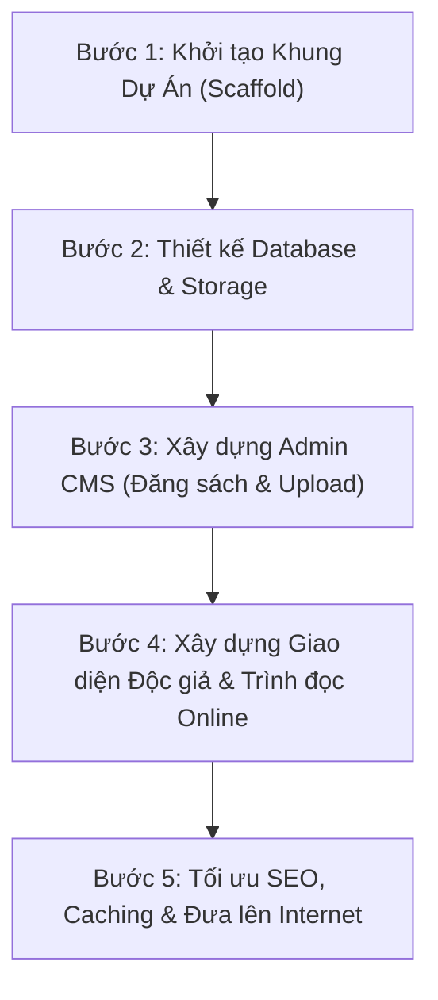

# KẾ HOẠCH HÀNH ĐỘNG TRIỂN KHAI DỰ ÁN (ACTION PLAN)
## XÂY DỰNG WEBSITE THƯ VIỆN SÁCH & ĐỌC SÁCH ONLINE

---

## 1. Mục Tiêu Ngay Lúc Này: Xây Dựng Bản MVP (Giai Đoạn 1)

Thay vì cố gắng hoàn thiện toàn bộ các tính năng phức tạp (như thanh toán, sách nói, mạng xã hội) ngay lập tức, mục tiêu hiện tại là **chạy được phiên bản MVP (Minimum Viable Product)** với 2 luồng cốt lõi:
1. **Luồng Quản trị (Admin):** Đăng nhập -> Thêm danh mục & tác giả -> Đăng sách mới & upload file PDF/EPUB lên cloud -> Quản lý danh sách sách.
2. **Luồng Độc giả (Reader):** Xem danh sách sách mới -> Tìm kiếm sách theo tên/tác giả -> Xem trang chi tiết -> Mở trình đọc PDF/EPUB trực tiếp trên web -> Bấm nút tải file về máy.

---

## 2. Lộ Trình 5 Bước Triển Khai Thực Tế



---

### BƯỚC 1: Khởi Tạo Dự Án & Cấu Trúc Thư Mục (Ngày 1)
* **Quyết định công nghệ đề xuất:**
  * **Framework:** Next.js (App Router) + TypeScript + Tailwind CSS (Vừa dựng UI Người đọc chuẩn SEO, vừa có sẵn Route Handlers làm API Backend và làm giao diện Admin).
  * **ORM:** Prisma hoặc Drizzle ORM (Quản lý Database trực quan, an toàn type-safe).
  * **UI Kit:** Shadcn UI / Lucide Icons (Giao diện hiện đại, tinh gọn, load nhanh).
* **Cấu trúc thư mục mẫu:**
  ```text
  thu-vien-sach/
  ├── prisma/
  │   └── schema.prisma         # Định nghĩa các bảng dữ liệu
  ├── public/
  │   └── uploads/              # Lưu ảnh tạm (nếu dev local)
  ├── src/
  │   ├── app/
  │   │   ├── (reader)/         # Nhóm route dành cho người đọc
  │   │   │   ├── page.tsx      # Trang chủ
  │   │   │   ├── sach/         # Trang danh mục & chi tiết sách
  │   │   │   └── doc-sach/     # Giao diện trình đọc online (PDF/EPUB)
  │   │   ├── (admin)/          # Nhóm route dành cho quản trị
  │   │   │   └── admin/        # Dashboard, Quản lý sách, tác giả...
  │   │   └── api/              # API routes xử lý upload, streaming, auth
  │   ├── components/           # Component dùng chung (Navbar, Reader, Card...)
  │   └── lib/                  # Cấu hình DB, Cloudflare R2, auth...
  ```

---

### BƯỚC 2: Thiết Kế Database & Kết Nối Lưu Trữ (Ngày 2)
* **Cơ sở dữ liệu (Database):**
  * Thiết lập PostgreSQL (hoặc MySQL/SQLite cho môi trường dev nhanh).
  * Tạo các bảng cơ sở:
    1. `User` (Tài khoản, quyền Admin/User).
    2. `Category` (Danh mục: Kinh tế, Văn học, Tâm lý...).
    3. `Author` (Tác giả, tiểu sử, ảnh đại diện).
    4. `Book` (Tiêu đề, slug, mô tả, ảnh bìa, năm XB, lượt xem, lượt tải).
    5. `BookFile` (Liên kết file PDF, EPUB, dung lượng, đường dẫn storage).
* **Kết nối Lưu trữ (Object Storage):**
  * Tạo tài khoản và bucket trên **Cloudflare R2** (hoặc dùng thư mục local tạm thời).
  * Viết module upload file (ảnh bìa, PDF, EPUB) và sinh link truy cập an toàn.

---

### BƯỚC 3: Phát Triển Phân Hệ Quản Trị - Admin CMS (Ngày 3 - 5)
* [ ] Xây dựng trang Đăng nhập quản trị viên (NextAuth.js / JWT).
* [ ] Xây dựng màn hình Quản lý Thể loại & Tác giả (Thêm / Sửa / Xóa).
* [ ] Xây dựng Form Thêm/Sửa Sách mới:
  * Nhập thông tin sách, mô tả rút gọn.
  * Upload ảnh bìa (tự động nén ảnh).
  * Upload file PDF / EPUB (tiến trình % upload thanh bar).
* [ ] Bảng danh sách sách (Hỗ trợ phân trang, tìm kiếm, lọc theo thể loại, nút bật/tắt hiển thị).

---

### BƯỚC 4: Phát Triển Phân Hệ Người Đọc (Reader Portal) (Ngày 6 - 8)
* [ ] **Trang chủ:**
  * Thanh tìm kiếm nhanh trên đầu trang.
  * Danh mục thể loại nổi bật.
  * Danh sách Sách Mới Cập Nhật, Sách Đọc Nhiều Nhất.
* [ ] **Trang Chi Tiết Sách (`/sach/[slug]`):**
  * Hiển thị đầy đủ thông tin: Ảnh bìa, Tác giả, Nhà xuất bản, Giới thiệu nội dung.
  * Nút bấm: **"Đọc Sách Online"** và **"Tải Sách (PDF / EPUB)"**.
* [ ] **Trình Đọc Sách Trực Tuyến (`/doc-sach/[slug]`):**
  * Tích hợp `react-pdf` / `PDF.js` cho file PDF (Hỗ trợ lật trang, cuộn mượt, phóng to/thu nhỏ).
  * Tích hợp `epubjs-react` cho file EPUB (Hỗ trợ đổi font, chỉnh chế độ nền tối Dark Mode).
* [ ] **Trang Tìm kiếm & Danh mục:**
  * Lọc sách theo danh mục, sắp xếp theo thời gian hoặc lượt xem.

---

### BƯỚC 5: Tối Ưu, Kiểm Thử & Triển Khai (Ngày 9 - 10)
* [ ] **Tối ưu SEO:** Tự động sinh thẻ Meta (Open Graph, Twitter card), Dynamic Sitemap `sitemap.xml`, Schema Markup `Book`.
* [ ] **Bảo vệ liên kết:** Giới hạn tải file (Rate limiting) tránh bot tải vét băng thông.
* [ ] **Triển khai Production:**
  * Frontend + Backend API: Đẩy lên **Vercel** hoặc VPS (Docker).
  * Database: Dùng Neon.tech / Supabase / Render (PostgreSQL miễn phí/rẻ).
  * Storage: Kết nối Cloudflare R2.
  * Domain: Trỏ tên miền chính thức qua Cloudflare CDN.

---

## 3. Checklist Các Việc CẦN LÀM NGAY BÂY GIỜ

Để bắt đầu ngay lập tức, đây là 3 hành động cụ thể cần quyết định và thực hiện:

- [ ] **Hành động 1:** Xác nhận lựa chọn công nghệ (Đề xuất: **Next.js 14/15 App Router + Prisma + Tailwind CSS**).
- [ ] **Hành động 2:** Khởi tạo mã nguồn dự án vào thư mục làm việc hiện tại (`c:\Users\admin\OneDrive\Thành\Thư Viện`).
- [ ] **Hành động 3:** Viết mã file `schema.prisma` định nghĩa cơ sở dữ liệu và dựng giao diện khung ban đầu.
